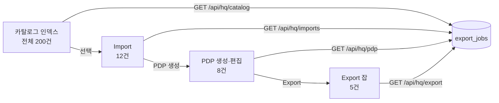

# HQ 파이프라인 UI 분리 기획안

## 📋 현황 분석

### 현재 문제
`CatalogPipelinePanel` 컴포트가 `focus` prop에 따라 **제목만 변경**할 뿐, 실제로는 **동일한 데이터**를 로드하고 있음:

| 페이지 | 현재 동작 | 기대 동작 |
|--------|----------|----------|
| 카탈로그 인덱스 | 전체 카탈로그 목록 ✅ | 전체 카탈로그 목록 ✅ |
| Import | 전체 카탈로그 목록 ❌ | **Import된 항목만** 목록 ✅ |
| PDP 생성·편집 | 전체 카탈로그 + PDP 문서 ❌ | **PDP 문서만** 목록 ✅ |
| Export 잡 | 전체 카탈로그 + Export 잡 ❌ | **Export 잡만** 목록 ✅ |

### 파이프라인 흐름 (최종 정의)
```
[카탈로그 인덱스] → [Import] → [PDP 생성·편집] → [Export 잡]
     (전체 200건)      (선택 1건)    (AI 생성 보관)      (판매 중인 상품)
         ↓                  ↓              ↓                    ↓
    탐색/선          Import 관리    AI로 상품페이지 생성    카테고리/가격 설정
                                        변경된 PDP 보관       내보내기/진열 수정
```

### 각 단계의 명확한 역할

#### 1. 카탈로그 인덱스 (`/hq/pipeline/catalog`)
- **목적**: 공급처(CJ Dropshipping 등)의 전체 상품 카탈로그 탐색
- **데이터**: 전체 카탈로그 인덱스 (importState 무관)
- **핵심 기능**: 
  - 전체 목록 탐색 (그리드/리스트 뷰)
  - 검색/필터 (제목, 카테고리, 가격)
  - 개별 항목 선택 → Import로 전달

#### 2. Import (`/hq/pipeline/import`)
- **목적**: 카탈로그에서 선택한 항목들의 Import 상태 관리
- **데이터**: `importState=imported` 항목만
- **핵심 기능**:
  - Import된 항목만 목록 표시
  - Import 상태 관리 (pending → imported → failed)
  - 택 → PDP 생성으로 전달

#### 3. PDP 생성·편집 (`/hq/pipeline/pdp`)
- **목적**: Import된 상품들의 상세 페이지(PDP)를 AI로 생성 및 보관
- **데이터**: PDP 문서 목록 (catalogId 참조)
- **핵심 기능**:
  - **AI로 상품페이지 생성** (Gemini 활용)
  - 생성된 PDP 보관 (버전 관리)
  - PDP 편집 (제목, 설명, CTA, 앤매너)
  - 택 → Export로 전달

#### 4. Export 잡 (`/hq/pipeline/export`)
- **목적**: PDP가 완성된 상품들을 각 채널로 송출 (실제 판매 중인 상품)
- **데이터**: Export 잡 목록 (documentId 참조)
- **핵심 기능**:
  - **카테고리/가격 설정** 후 내보내기
  - 채널별 Export (LEXI, Coupang, Cafe24, Shopify, Amazon AU)
  - **판매 보류** → 다시 PDP로 반환
  - **진열 상태 수정** (active/paused/hidden)

---

## 🎯 목표

각 단계가 **자신의 데이터 소스**와 **고유 기능**을 가지도록 분리

---

##  설계안

### 1. 카탈로그 인덱스 (`/hq/pipeline/catalog`)

**목적**: 공급처(CJ Dropshipping 등)의 전체 상품 카탈로그 탐색

**데이터 소스**: 
- `GET /api/hq/catalog?supplier=cjdropshipping`
- 전체 카탈로그 인덱스 (importState 무관)

**핵심 기능**:
- ✅ 전체 카탈로그 목록 (그리드/리스트 뷰)
- ✅ 검색/필터 (제목, 카테고리, 가격)
- ✅ 개별 항목 선 (Import 후보 선정)
- ✅ 썸네일 미리보기
- ✅ 페이지네이션 (100건씩)
- ✅ Import 버튼 → 선택 항목을 Import 페이지로 전달

**UI 특징**:
- "선택 Import (N)" 버튼으로 Import 페이지와 연결
- importState 컬럼으로 상태 표시 (none/imported/failed)

---

### 2. Import (`/hq/pipeline/import`)

**목적**: 카탈로그에서 선택한 항목들의 Import 상태 관리

**데이터 소스**: 
- `GET /api/hq/catalog?supplier=cjdropshipping&importState=imported`
- 또는 `GET /api/hq/imports` (신규 엔드포인트)

**핵심 기능**:
- ✅ **Import된 항목만** 목록 표시
- ✅ Import 상태 관리 (pending → imported → failed)
- ✅ Import 실행/재시도
- ✅ Import 히스토리 (언제 Import되었는지)
- ✅ PDP 생성 버튼 → PDP 페이지로 전달

**UI 특징**:
- 카탈로그 인덱스와 달리 **선택된 항목만** 표시
- Import 날짜/시간 표시
- 패 항목 재시도 기능

---

### 3. PDP 생성·편집 (`/hq/pipeline/pdp`)

**목적**: Import된 상품들의 상세 페이지(PDP) 생성 및 편집

**데이터 소스**: 
- `GET /api/hq/pdp`
- PDP 문서 목록 (catalogId 참조)

**핵심 기능**:
- ✅ **PDP 문서만** 목록 표시
- ✅ PDP 생성 (Gemini AI 활용)
- ✅ PDP 편집 (제목, 설명, CTA, 톤앤매너)
- ✅ PDP 상태 관리 (draft → review → published)
- ✅ Export 버튼 → Export 페이지로 전달

**UI 특징**:
- PDP 네일 미리보기
- AI 생성 콘텐츠 편집기
- 버전 관리 (이전 버전 비교)

---

### 4. Export 잡 (`/hq/pipeline/export`)

**목적**: PDP가 완성된 상품들을 각 채널로 송출

**데이터 소스**: 
- `GET /api/hq/export`
- Export 잡 목록 (documentId 참조)

**핵심 기능**:
- ✅ **Export 잡만** 목록 표시
- ✅ 채널별 Export (LEXI, Coupang, Cafe24, Shopify, Amazon AU)
- ✅ Export 상태 추적 (pending → processing → completed → failed)
- ✅ Export 재시도
- ✅ 채널별 필터

**UI 특징**:
- 채널별 색상 코딩
- Export 진행률 표시
- 실패 항목 재시도 기능

---

## 🔧 구현 계획

### Phase 1: API 분리 (1-2일)

#### 1.1 Import 전용 엔드포인트 추가
```typescript
// src/app/api/hq/imports/route.ts
GET /api/hq/imports?supplier=cjdropshipping&status=imported
```

#### 1.2 기존 catalog 엔드포인트에 필터 추가
```typescript
// src/app/api/hq/catalog/route.ts
GET /api/hq/catalog?supplier=cjdropshipping&importState=imported
```

### Phase 2: 컴포넌트 분리 (2-3일)

#### 2.1 CatalogPipelinePanel 리팩토링
```typescript
// 옵션 A: focus prop에 따라 완전히 다른 로직
export function CatalogPipelinePanel({ focus }: { focus: "catalog" | "import" | "pdp" | "export" }) {
  if (focus === "catalog") return <CatalogIndexPanel />;
  if (focus === "import") return <ImportPanel />;
  if (focus === "pdp") return <PdpPanel />;
  if (focus === "export") return <ExportPanel />;
}

// 옵션 B: 별도 컴포넌트로 분리
export function CatalogIndexPanel() { ... }
export function ImportPanel() { ... }
export function PdpPanel() { ... }
export function ExportPanel() { ... }
```

#### 2.2 각 패널 컴포넌트 구현
- `CatalogIndexPanel`: 전체 카탈로그 탐색
- `ImportPanel`: Import된 항목 관리
- `PdpPanel`: PDP 문서 관리
- `ExportPanel`: Export 잡 관리

### Phase 3: UI/UX 개선 (1-2일)

#### 3.1 진행 상태 표시
```
카탈로그 200건 → Import 12건 → PDP 8건 → Export 5건
```

#### 3.2 단계 간 이동 링크
- Import 페이지 → "카탈로그에서 더 선택하기" 링크
- PDP 페이지 → "Import 목록 보기" 링크
- Export 페이지 → "PDP 편집하기" 링크

#### 3.3 시각적 구분
- 각 단계별 고유 아이콘/색상
- 진행률 바 또는 단계 표시기

---

## 📊 데이터 흐름도



---

## ✅ 검증 기준

### 카탈로그 인덱스
- [ ] 전체 카탈로그 목록 표시 (importState 무관)
- [x] 그리드/리스트 뷰 전환 (헤더 토글, 카탈로그·Import·PDP 기본 그리드)
- [ ] 항목 선택 → Import 버튼 활성화
- [ ] 선택된 항목 수 표시

### Import
- [ ] **Import된 항목만** 표시 (importState=imported)
- [ ] Import 날짜/시간 표시
- [ ] 실패 항목 재시도 기능
- [ ] 카탈로그 인스와 명확히 구분

### PDP 생성·편집
- [ ] **PDP 문서만** 표시
- [ ] AI 생성 콘텐츠 편집
- [ ] PDP 상태 표시 (draft/review/published)

### Export 잡
- [ ] **Export 잡만** 표시
- [ ] 채널별 필터
- [ ] Export 상태 추적

---

## 🎨 UI 목업 (개요)

### 카탈로그 인덱스
```
┌─────────────────────────────────────────┐
│ 카탈로그 인덱스          [☰ 목록] [ 그리드] │
│ 인덱스 200건 · Import 12건               │
├─────────────────────────────────────────
│ [카테고리] [검색창]              [검색]   │
│ [선택 Import (3)] [갱신]                 │
...
│ 작업진행  카탈로그 n → Import n → PDP n → Export n │
─────────────────────────────────────────┤
│  2608180140061624200  Beard Brush...   │
│ ☐ 2608180141051608700  Solid-color...   │
│ ☑ 2608180142271607700  Solid-color...   │
─────────────────────────────────────────┘
```

### Import
```
┌─────────────────────────────────────────┐
│ Import                     [☰ 목록] [⊞ 그리드] │
│ Import된 항목 12건                       │
├─────────────────────────────────────────┤
│ [전체] [성공] [실패]                     │
│ [PDP 생성 (3)]                           │
├─────────────────────────────────────────┤
│ ✓ 2608180140061624200  Beard Brush...   │
│   Import: 2026-08-18 14:30              │
│ ✓ 2608180142271607700  Solid-color...   │
│   Import: 2026-08-18 14:30              │
─────────────────────────────────────────┘
```

---

## 📝 다음 단계

1. **기획안 검토** — 이 문서 확인 후 피드백
2. **API 설계 확정** — 엔드포인트 구조 확정
3. **구현 시작** — Phase 1부터 순차 진행
4. **테스트** — 각 단계별 기능 검증
5. **배포** — Vercel 배포 후 실제 데이터로 검증

---

##  관련 문서

- [lexi-master-spec.md](./lexi-master-spec.md) — 전체 설계 명세
- [lexi-catalog-pdp-pipeline.md](./lexi-catalog-pdp-pipeline.md) — 카탈로그→PDP 파이프라인
- [local-dev.md](./local-dev.md) — 로컬 개발 가이드
